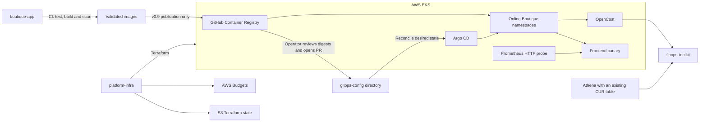

# Platform architecture

Terraform creates separate EKS environments for nonprod and prod. The nonprod cluster hosts dev,
staging and eligible pull request previews. Argo CD reads a cluster-specific bootstrap path so a
nonprod installation cannot accidentally reconcile the production overlay through its normal generator.

All four components are directories of one monorepo. Root workflows are active; nested workflows are standalone examples. Main pushes build and scan without publishing. The `v0.9` tag workflow publishes a set of images from the validated current main revision. An operator prepares a GitOps pull request that records the image digests
and target environment before Argo CD sees them. Argo Rollouts runs the frontend update and queries Prometheus
for candidate health. OpenCost reads Kubernetes allocation, and the FinOps CLI keeps those figures separate
from optional AWS billing data.
