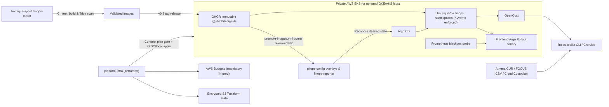

# Platform Architecture

Terraform provisions isolated private AWS EKS environments for `nonprod` (2 AZs, 1 shared NAT Gateway, 2 Spot `m6i.large` nodes) and `prod` (3 AZs, configurable `nat_per_az` defaulting to 3 NAT Gateways, 3 On-Demand `m6i.large` nodes, and a mandatory monthly AWS Budget), alongside optional nonprod `envs/gke` and `envs/aks` roots. Routine cluster access (`operator_role_arn`) defaults to least-privilege `AmazonEKSViewPolicy`, while an optional distinct `break_glass_role_arn` grants `AmazonEKSClusterAdminPolicy` for initial `bootstrap-argocd.sh` setup and emergency recovery. The `nonprod` cluster hosts `dev`, `staging`, and eligible pull request `preview` environments; Argo CD reads a cluster-specific bootstrap path (`bootstrap/nonprod`, `bootstrap/nonprod-managed`, or `bootstrap/prod`) so nonprod cannot reconcile production workloads.

All platform components reside in one monorepo governed by root `.github/workflows/` (retired nested component workflows have been consolidated at root). Every push to `main` runs `Release validation` (`ci.yml`), including offline Terraform plan generation (`offline_plan_check.py`) checked by Conftest (`policies/tagging.rego`), optional Infracost PR summaries, SHA-verified `kubeconform` + `kyverno` enforcement across `boutique-*` and `finops` namespaces, multi-language service tests, and container vulnerability scans without pushing images. Tagging `v0.9` verifies a green `main` validation run, publishes scanned images to GHCR, and triggers `promote-images.yml` (`scanned-images.py --apply-gitops`) to open a reviewed GitOps Pull Request updating Kustomize `@sha256` digests before Argo CD reconciles them. Argo Rollouts gates frontend updates on Prometheus HTTP probe health, while `finops-toolkit` reports OpenCost allocations separately from AWS CUR/Athena billing, normalized FOCUS 1.0/1.1 CSV exports, and read-only Cloud Custodian waste candidates.
