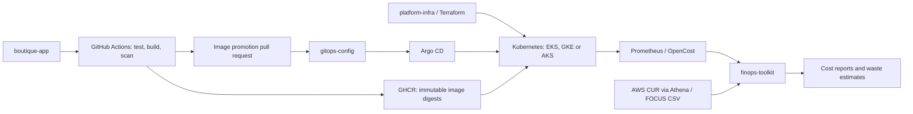

# Cost-aware GitOps Platform

[](https://github.com/workwithcrow12-art/cost-aware-gitops-platform/actions/workflows/ci.yml)
[](.github/docs/releases/v0.9.md)
[](finops-toolkit/README.md)
[](LICENSE)

Reference DevOps and FinOps platform lab connecting **private AWS EKS infrastructure (Terraform)**, **digest-pinned GitOps delivery with canary analysis (Argo CD & Rollouts)**, **Kubernetes admission/network security (Kyverno)** and **multi-source cloud cost & waste reporting (OpenCost, AWS CUR/Athena, FOCUS CSV, Cloud Custodian)** around Google's [Online Boutique](https://github.com/GoogleCloudPlatform/microservices-demo) microservices workload.

**AWS EKS is the primary deployment path.** Optional Terraform roots support nonproduction GKE and AKS labs. Local tests, mocked infrastructure plans, policy gates and synthetic FinOps demos run without cloud credentials; live cloud deployment, recovery and measured cost savings require a separate lab exercise.

[Architecture](.github/docs/architecture/overview.md) · [5-minute demo (Tiếng Việt)](.github/docs/demo.md) · [Verification & case study](.github/docs/case-study.md) · [Portfolio & design tradeoffs](.github/docs/portfolio.md) · [v0.9 release notes](.github/docs/releases/v0.9.md) · [GitHub Actions](https://github.com/workwithcrow12-art/cost-aware-gitops-platform/actions) · [MIT License](LICENSE) · [NOTICE](NOTICE)

## Key engineering highlights

- **Infrastructure & Governance:** Separate `nonprod` (Spot) and `prod` (On-Demand) private EKS environments, encrypted S3 state, AWS Budgets, GitHub OIDC, mocked `terraform test` suites and OPA/Conftest cost-tag enforcement (`env`, `team`, `project`, `owner`).
- **Supply-Chain & Policy Gates:** Multi-language CI across 11 services, Trivy `HIGH`/`CRITICAL` image blocking, immutable `@sha256` digest promotion PRs, default-deny `NetworkPolicy`, Sealed Secrets and Kyverno `restricted` pod security + resource/label enforcement.
- **Controlled GitOps Delivery:** Argo CD `ApplicationSet` environments (`dev`, `staging`, PR `preview`, manual-sync `prod`), scheduled weekday off-hours scaling (`GoKubeDownscaler`) in nonprod, and Prometheus-probed Argo Rollouts frontend canaries.
- **Data-Safe FinOps CLI (`finops-toolkit`):**
  - Keeps **OpenCost workload allocations** and **AWS CUR billing** separate instead of summing overlapping totals.
  - Rejects incomplete 14-day UTC comparison windows rather than treating missing billing days as `$0`.
  - Normalizes multi-cloud spend from **FOCUS 1.0/1.1 CSV** exports (preserving credits and per-currency totals) and estimates monthly waste from read-only **Cloud Custodian** findings.

The platform infrastructure, delivery automation, policy gates, FinOps CLI and verification suites are original to this project; the storefront services originate from Google's Online Boutique.

## Architecture



Nonproduction hosts dev, staging and eligible pull request previews. Production uses a separate bootstrap and configuration. Dev and staging sync automatically; production requires operator approval in Argo CD. Canary analysis applies to the frontend. To restore a previous desired version, revert its GitOps change and sync the application.

## Repository structure

| Component | Responsibilities |
| --- | --- |
| [platform-infra](platform-infra/README.md) | Private EKS infrastructure, optional GKE/AKS labs, S3 state, AWS Budgets, GitHub OIDC, cost tags, optional Athena/Glue/IRSA provisioning and Terraform policy checks. |
| [gitops-config](gitops-config/README.md) | Argo CD/ApplicationSet configuration, Kustomize overlays, Helm add-ons, digest-pinned images, frontend canaries, Kyverno, network policies, scheduled nonprod scaling and observability. |
| [boutique-app](boutique-app/README.md) | Online Boutique source, service tests, image build/scan/publish tooling, reviewed preview releases and checkout smoke tests. |
| [finops-toolkit](finops-toolkit/README.md) | OpenCost/Athena reports, FOCUS CSV comparisons by provider/environment/team/currency and read-only Cloud Custodian waste summaries. |
| [.github](.github/README.md) | Active workflows, architecture decisions, runbooks, release notes and verification evidence. |

This is a **monorepo**. Active automation lives in the root `.github/workflows` directory. Nested component workflows remain standalone examples and do not run here. Run component commands from the directory specified in each component README. Historical ADR decisions and nested standalone examples retain the earlier multi-repository layout. Automatic promotion, Terraform apply/drift and scheduled waste collection are not active root workflows.

## Quick start: offline demo

Use Python 3.11 or newer. From the project root, run `python scripts/portfolio_demo.py` to run the offline checks and save logs plus all three reports in a new directory. See the [five-minute walkthrough, in Vietnamese](.github/docs/demo.md) and [dated verification record](.github/docs/evidence/portfolio-readiness-2026-11-16.md). The individual commands below read committed synthetic fixtures, need no cloud credentials and send no notifications.

```powershell
$env:PYTHONPATH = (Resolve-Path finops-toolkit/src).Path
python -m unittest discover -s finops-toolkit/tests -v
python -m finops.cli report --fixtures finops-toolkit/tests/fixtures
python -m finops.cli cloud-report --input finops-toolkit/tests/fixtures/focus_sample.csv --as-of 2026-01-19
python -m finops.cli waste --input finops-toolkit/tests/fixtures/custodian --dry-run
```

In Bash, replace the first line with `export PYTHONPATH="$PWD/finops-toolkit/src"`.

Example outputs: [weekly report](.github/docs/evidence/weekly-report.md) and [waste summary](.github/docs/evidence/waste-report.md). Their amounts illustrate reporting behavior with synthetic data; they are not measured savings.

<details>
<summary><strong>Preview offline demo output (synthetic fixtures, zero credentials)</strong></summary>

```text
$ python scripts/portfolio_demo.py
PASS: finops-tests.log       # 42 unit tests (missing-day rejection, credits, currencies, notifications)
PASS: digest-tests.log       # 6 release-digest completeness & revision checks
PASS: weekly-report.md       # OpenCost ($89.47 vs $104.00) and AWS CUR ($140.00 vs $165.00), shown separately
PASS: cloud-report.md        # Multi-cloud FOCUS CSV (AWS, GCP, Azure: 43.75 USD/week)
PASS: waste-report.md        # 4 Cloud Custodian candidates (~$27.88/month at illustrative default rates)
```

</details>

## Running a cloud lab

1. Follow the [quick-start guide, in Vietnamese](.github/docs/quick-start.md) to select a cloud, install tools and prepare access.
2. For AWS, use the [cluster rebuild runbook](.github/docs/runbooks/khoi-phuc-cluster-tu-git.md) to prepare state and budget settings, provision nonprod and bootstrap Argo CD.
3. Update repository URLs, registry references, IAM/OIDC settings and environment variables for your account. Prepare cluster-specific secrets using the [GitOps instructions](gitops-config/README.md).
4. Verify application sync, checkout, a failed canary and [rollback](.github/docs/runbooks/rollback-thu-cong.md). Record the deployed revisions and results.
5. Collect sufficient cost history before enabling live reports. Follow the [teardown instructions](platform-infra/README.md#tear-down), including cleanup of Kubernetes-managed load balancers and persistent volumes.

Read the [AWS lab prerequisites and evidence checklist, in Vietnamese](.github/docs/runbooks/aws-lab-evidence.md) before provisioning. A Free Tier account does not establish that this entire architecture is free; the current zero-cost lab request remains unexecuted pending verification of account eligibility and access.

EKS, EC2, NAT gateways, storage and logging incur charges. AWS Budgets provides alerts; operators still need to monitor spending and remove unused resources.

## Important considerations

| Area | What to account for |
| --- | --- |
| Verification scope | Local checks, Terraform mock plans and manifest rendering do not prove a live EKS/GKE/AKS deployment. Cluster bootstrap, controller reconciliation, checkout and rollback need deployment evidence. Check Actions for the result of each commit. |
| Private access | Kubernetes API endpoints are private. The host running Helm/kubectl needs routed access, working DNS and the correct operator permissions. A GitHub-hosted runner does not automatically have that network path. |
| Approvals and publication | Configure branch protection, required reviewers and GitHub environments on GitHub; workflow YAML alone does not enable them. Publishing source/images does not update a running cluster. GitOps base images remain pinned upstream until a deployment change is reviewed. |
| Canary signal | Basic canary weights target replica ratios rather than exact request percentages. HTTP probes check candidate availability but do not cover the full checkout journey or all user traffic. |
| Availability and storage | Node groups have fixed node counts. Redis and nonprod Prometheus use ephemeral storage; the production Prometheus profile has a persistent volume. Availability, backups and recovery need verification before use beyond the lab. |
| Sample application | Payment and email services are mocks. The optional shopping assistant (`shoppingassistantservice`) is GCP-specific (AlloyDB + Gemini) and intentionally excluded from the base deployment. |
| Cost data | Weekly comparisons need 14 complete UTC days. The FOCUS reader accepts a documented subset and does not download billing exports. OpenCost and CUR can overlap, so their totals must remain separate. Waste estimates need current rates, usage and ownership checks. |
| Secrets and security | Seal secrets for the target cluster and keep plaintext credentials out of Git. Image scans reflect the versions and vulnerability database used by that run; dependency updates and future scans remain necessary. |

## Remaining work and improvements

These are deployment prerequisites or follow-up improvements, not completed features.

| Priority | Work item | Completion evidence |
| --- | --- | --- |
| High | Validate the full flow on real cloud infrastructure | Record provisioning, bootstrap, checkout, failed-canary handling, rollback and teardown with commit IDs. Measure recovery time and compare billing over equivalent workload periods. |
| High | Establish data durability and recovery | Choose suitable Redis/HA and backup arrangements, test restores and verify metrics retention. Document acceptable data loss and recovery time. |
| High | Finish environment-specific operations | Verify IAM/OIDC, approval settings, alert destinations and secrets. Document credential rotation and Sealed Secrets key recovery. |
| Medium | Keep documentation and examples aligned as automation evolves | Active guides now describe the monorepo and manual promotion; nested standalone examples and historical verification records are labeled. Recheck hosted workflows when publication behavior changes. |
| Medium | Validate multi-cloud deployment and billing inputs | Exercise GKE/AKS nonprod labs, reconcile normalized exports against source billing and document checks for duplicate charges or omitted providers. |
| Medium | Evaluate autoscaling and resource sizing | Measure load and spending before enabling the opt-in `modules/karpenter` Terraform module, rightsizing or Cost Anomaly Detection; compare results with the fixed-node baseline. |
| Before enabling | Provision GCP dependencies for the optional shopping assistant | Supply AlloyDB, Secret Manager and Gemini credentials and add hardened Kubernetes manifests before enabling `ENABLE_ASSISTANT=true`. |

Athena provisioning, Kyverno tests, a baseline Grafana dashboard, persistent production Prometheus storage and failure notifications already exist. See the [v0.9 notes](.github/docs/releases/v0.9.md) and [earlier review/remediation comparison, in Vietnamese](.github/docs/comparison-remediation.md) before adding overlapping tooling.

## Further documentation

- [Portfolio notes and contribution boundaries](.github/docs/portfolio.md)
- [Verification commands and measurement protocol](.github/docs/case-study.md)
- [Cost alert runbook](.github/docs/runbooks/xu-ly-canh-bao-chi-phi.md)
- [Contributing](.github/CONTRIBUTING.md) and [security reporting](.github/SECURITY.md)
- [Published releases](https://github.com/workwithcrow12-art/cost-aware-gitops-platform/releases)

## License

The original platform, delivery automation, FinOps tooling and documentation in this project are available under the MIT License. Copyright (c) 2026 Dũng Nguyễn. [MIT License](LICENSE)

The application in `boutique-app` derives from [Google Online Boutique / microservices-demo](https://github.com/GoogleCloudPlatform/microservices-demo) and retains its [Apache License 2.0](boutique-app/LICENSE) and source copyright notices. The MIT License does not replace those terms. Third-party libraries, images and tools retain their own licenses.
