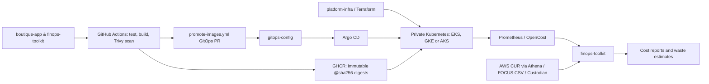

# Cost-aware GitOps Platform

[](https://github.com/workwithcrow12-art/cost-aware-gitops-platform/actions/workflows/ci.yml)
[](.github/docs/releases/v0.9.md)
[](finops-toolkit/README.md)
[](LICENSE)

Reference DevOps and FinOps platform lab connecting **private AWS EKS infrastructure (Terraform)**, **digest-pinned GitOps delivery with canary analysis (Argo CD & Rollouts)**, **Kubernetes admission/network security (Kyverno)**, and **multi-source cloud cost & waste reporting (OpenCost, AWS CUR/Athena, FOCUS CSV, Cloud Custodian)** around Google's [Online Boutique](https://github.com/GoogleCloudPlatform/microservices-demo) microservices workload.

**AWS EKS is the primary deployment path.** Optional Terraform roots support nonproduction GKE and AKS labs. Local unit suites, offline Terraform plans, policy gates, synthetic FinOps demos, and the Cloud Lab Readiness Kit run without cloud credentials; live cloud deployment, recovery timing, and measured cost savings require an authenticated lab run.

[Architecture](.github/docs/architecture/overview.md) · [5-minute demo](.github/docs/demo.md) · [Verification & case study](.github/docs/case-study.md) · [Portfolio & design tradeoffs](.github/docs/portfolio.md) · [v0.9 release notes](.github/docs/releases/v0.9.md) · [GitHub Actions](https://github.com/workwithcrow12-art/cost-aware-gitops-platform/actions) · [MIT License](LICENSE) · [NOTICE](NOTICE)

## Key engineering highlights

- **Infrastructure & Governance:** Separate `nonprod` (Spot, 1 NAT) and `prod` (On-Demand, configurable `nat_per_az` 3-NAT HA, mandatory monthly AWS Budget) private EKS environments, least-privilege `AmazonEKSViewPolicy` operator access with optional `break_glass_role_arn` (`AmazonEKSClusterAdminPolicy`), encrypted S3 state, GitHub OIDC, mocked `terraform test` suites, offline Terraform plan `conftest test` cost-tag gates (`env`, `team`, `project`, `owner`), and Infracost PR summaries.
- **Supply-Chain & Policy Gates:** Multi-language CI across all Boutique services, SHA-verified `kubeconform` + `kyverno` CLI gates, Trivy `HIGH`/`CRITICAL` image blocking, automated/manual `@sha256` digest promotion PRs (`promote-images.yml`), default-deny `NetworkPolicy`, Sealed Secrets, and Kyverno `restricted` pod security + digest/resource/cost-label enforcement across both `boutique-*` and `finops` namespaces.
- **Controlled GitOps Delivery:** Argo CD `ApplicationSet` environments (`dev`, `staging`, PR `preview`, manual-sync `prod`) pinned to verified `v0.9` GHCR `@sha256` digests, scheduled weekday off-hours scaling (`GoKubeDownscaler`) in nonprod, and Prometheus-probed Argo Rollouts frontend canaries.
- **Data-Safe FinOps CLI (`finops-toolkit`) & Cloud Lab Kit:**
  - Keeps **OpenCost workload allocations** and **AWS CUR billing** separate instead of summing overlapping totals.
  - Rejects incomplete 14-day UTC comparison windows rather than treating missing billing days as `$0`.
  - Normalizes multi-cloud spend from **FOCUS 1.0/1.1 CSV** exports (preserving credits and per-currency totals) and estimates monthly waste from read-only **Cloud Custodian** findings.
  - Includes an offline-first **Cloud Lab Readiness & Evidence Kit** (`scripts/cloud_lab_preflight.py` and `scripts/cloud_lab_runner.py`) for tool/env/private-API checks, `Decimal` regional session/30-day cost modeling, dry-run runbook planning, and secret-redacted live stage evidence logs.

The platform infrastructure, delivery automation, policy gates, FinOps CLI, and verification/readiness suites are original to this project; the storefront services originate from Google's Online Boutique.

## Architecture



Nonproduction hosts `dev`, `staging`, and eligible pull request `preview` deployments. Production uses a dedicated cluster bootstrap and manual Argo CD sync approval. Canary analysis gates the `frontend` service; restoring a previous desired state uses a reviewed Git revert PR in `gitops-config`.

## Repository structure

| Component | Responsibilities |
| --- | --- |
| [platform-infra](platform-infra/README.md) | Private EKS infrastructure, optional GKE/AKS labs, S3 state, mandatory `prod` AWS Budgets, least-privilege + break-glass EKS access, GitHub OIDC, Athena/Glue/IRSA, opt-in Karpenter, and offline Terraform plan policy checks. |
| [gitops-config](gitops-config/README.md) | Argo CD/`ApplicationSet` roots, Kustomize overlays pinned to `v0.9` GHCR `@sha256` digests, Helm add-ons, `finops-reporter`, frontend canaries, Kyverno (`boutique-*` & `finops`), network policies, nonprod downscaling, and observability. |
| [boutique-app](boutique-app/README.md) | Online Boutique source, multi-language service tests, image build/scan/publish scripts, `scanned-images.py` overlay digest promoter, and storefront checkout smoke tests. |
| [finops-toolkit](finops-toolkit/README.md) | OpenCost/Athena weekly comparisons, FOCUS 1.0/1.1 CSV multi-cloud reports by provider/environment/team/currency, and read-only Cloud Custodian waste summaries. |
| [.github](.github/README.md) & `scripts/` | Active monorepo CI/release/promotion/OIDC workflows, ADRs, English runbooks, release notes, offline portfolio demo, and Cloud Lab Readiness Kit. |

This is a **monorepo** where all active automation lives in root `.github/workflows/`: continuous validation (`ci.yml`, `finops.yml`, `services.yml`, `terraform.yml`, `gitops.yml`, `images.yml`), tagged GHCR publication + automated/manual GitOps digest promotion PRs (`release.yml`, `promote-images.yml`), and opt-in OIDC operational workflows (`terraform-apply.yml`, `terraform-drift.yml`, `custodian-weekly.yml`, which stay gated until AWS OIDC roles and repository variables are configured). Dormant nested `.github/workflows` directories were retired in favor of root monorepo workflows.

## Quick start: offline demo & cloud lab preflight

Use Python 3.11 or newer. From the project root, run `python scripts/portfolio_demo.py` to execute offline test suites and save logs plus all three synthetic FinOps reports in a fresh `.scratch/` directory. See the [5-minute walkthrough](.github/docs/demo.md) and [dated verification record](.github/docs/evidence/portfolio-readiness-2026-11-16.md). The individual commands below read committed synthetic fixtures, require no cloud credentials, and send no notifications:

```powershell
$env:PYTHONPATH = (Resolve-Path finops-toolkit/src).Path
python -m unittest discover -s finops-toolkit/tests -v
python -m finops.cli report --fixtures finops-toolkit/tests/fixtures
python -m finops.cli cloud-report --input finops-toolkit/tests/fixtures/focus_sample.csv --as-of 2026-01-19
python -m finops.cli waste --input finops-toolkit/tests/fixtures/custodian --dry-run
```

In Bash, replace the first line with `export PYTHONPATH="$PWD/finops-toolkit/src"`. Example outputs: [weekly report](.github/docs/evidence/weekly-report.md) and [waste summary](.github/docs/evidence/waste-report.md) (synthetic fixture illustrations, not measured cloud savings).

To check local cloud lab readiness, itemized `ap-southeast-1` hourly/session/30-day `Decimal` cost estimates, and a dry-run evidence plan without touching live cloud resources:

```bash
python scripts/cloud_lab_preflight.py --env nonprod --hours 2
python scripts/cloud_lab_runner.py --env nonprod --dry-run
```

<details>
<summary><strong>Preview offline demo output (synthetic fixtures, zero credentials)</strong></summary>

```text
$ python scripts/portfolio_demo.py
PASS: finops-tests.log       # 42 unit tests (missing-day rejection, credits, currencies, notifications)
PASS: digest-tests.log       # Release-digest completeness, revision & overlay promotion checks
PASS: weekly-report.md       # OpenCost ($89.47 vs $104.00) and AWS CUR ($140.00 vs $165.00), shown separately
PASS: cloud-report.md        # Multi-cloud FOCUS CSV (AWS, GCP, Azure: 43.75 USD/week)
PASS: waste-report.md        # 4 Cloud Custodian candidates (~$27.88/month at illustrative default rates)
```

</details>

## Running a cloud lab

1. Run `python scripts/cloud_lab_preflight.py --env nonprod --hours 2` and follow the [quick-start guide](.github/docs/quick-start.md) to select a cloud root, install pinned tools, and prepare private network access.
2. For AWS, follow the [cluster rebuild runbook](.github/docs/runbooks/khoi-phuc-cluster-tu-git.md) to provision `bootstrap/state-backend`, configure `TF_VAR_operator_role_arn` (`AmazonEKSViewPolicy`) plus `TF_VAR_break_glass_role_arn` (`AmazonEKSClusterAdminPolicy` for initial bootstrap) and `TF_VAR_budget` (mandatory in `prod`), apply `nonprod`, and bootstrap Argo CD.
3. Update repository URLs, IAM/OIDC settings, and cluster-bound Sealed Secrets using the [GitOps instructions](gitops-config/README.md).
4. Initialize an evidence folder via `python scripts/cloud_lab_runner.py --dry-run`, then verify application sync, storefront checkout (`--execute-stage smoke`), a `dev` [canary auto-abort drill](.github/docs/postmortems/001-canary-tu-rollback.md), and [Git revert rollback](.github/docs/runbooks/rollback-thu-cong.md).
5. Collect 14 complete UTC days of cost history before running live weekly comparisons. Follow the [teardown instructions](platform-infra/README.md#tear-down), removing Kubernetes-created LoadBalancers and `Retain`-policy EBS volumes before `terraform destroy`.

Read the [AWS lab prerequisites and evidence runbook](.github/docs/runbooks/aws-lab-evidence.md) before provisioning. A Free Tier account label does not make EKS (`$0.10/hr`), worker EC2 nodes, NAT Gateways (`$0.059/hr` + data), KMS, or EBS free; AWS Budgets sends alerts rather than hard-stopping resources.

## Important considerations

| Area | What to account for |
| --- | --- |
| Verification scope | Local unit suites, offline Terraform plans, and manifest renders do not prove a live EKS/GKE/AKS deployment. Cluster bootstrap, controller reconciliation, checkout smoke, and rollback require timestamped lab evidence. |
| Private access & least privilege | Kubernetes API endpoints are private (`endpoint_public_access = false`). Helm/`kubectl`/`kubeseal` need VPC routing and private DNS; GitHub-hosted runners lack private VPC paths by default. Routine `operator_role_arn` grants `AmazonEKSViewPolicy`; initial `bootstrap-argocd.sh` uses `break_glass_role_arn` (`AmazonEKSClusterAdminPolicy`). |
| Approvals & promotion | Configure GitHub Rulesets (see [CONTRIBUTING.md](.github/CONTRIBUTING.md)) and GitHub Environments in repository settings; YAML alone cannot enforce reviewer gates. `promote-images.yml` opens a PR with verified GHCR digests rather than pushing directly to `main`. |
| Canary signal | Basic canary weights target replica ratios rather than exact request percentages. Blackbox HTTP probes test `/` availability on candidate pods rather than full synthetic checkouts. |
| Availability & storage | Node groups use fixed counts by default (`prod` also defaults to `nat_per_az = true` across 3 AZs, `~$127–$129/mo` fixed NAT cost in `ap-southeast-1`). Redis and nonprod Prometheus use ephemeral storage; production Prometheus uses a single-AZ `Retain` gp3 PVC. |
| Sample application | Payment and email services are mocks. Optional `shoppingassistantservice` is GCP-specific (AlloyDB + Gemini) and intentionally excluded from the base deployment. |
| Cost data | Weekly comparisons require 14 complete UTC days. OpenCost and CUR overlap and stay separate. Waste estimates use default or env-configured rates and require ownership verification before cleanup. |
| Secrets & security | Encrypt Sealed Secrets per target cluster and keep plaintext credentials out of Git. Image scans reflect CVE databases at scan time; ongoing Dependabot updates and re-scans remain required. |

## Remaining work and improvements

These items represent live cloud validation steps or future extensions rather than completed claims:

| Priority | Work item | Completion evidence |
| --- | --- | --- |
| High | Validate the full lifecycle on live cloud infrastructure | Record provisioning, private-API bootstrap, checkout smoke, failed-canary abort, Git revert rollback, and clean teardown with commit SHAs and redacted logs via `cloud_lab_runner.py`. |
| High | Establish production data durability and backup recovery | Select HA Redis and backup/restore tooling, test volume restores, and document RPO/RTO targets. |
| High | Verify live environment IAM/OIDC, Rulesets, and alert routing | Exercise root `terraform-apply.yml`, `terraform-drift.yml`, `custodian-weekly.yml`, Alertmanager Slack webhooks, and Sealed Secrets key backup/recovery in a target account. |
| Medium | Validate multi-cloud GKE/AKS labs and billing reconciliation | Provision `envs/gke` and `envs/aks` in sandbox projects, verify `managed` bootstrap, and reconcile FOCUS CSV exports against cloud invoices. |
| Medium | Benchmark Karpenter autoscaling and rightsizing | Compare workload cost and latency with `enable_karpenter = true` against the fixed-node baseline before enabling Cost Anomaly Detection. |
| Before enabling | Provision GCP dependencies for `shoppingassistantservice` | Supply AlloyDB, Secret Manager, Gemini credentials, and hardened manifests before enabling `ENABLE_ASSISTANT=true`. |

Athena provisioning, Kyverno `boutique-*` + `finops` policy tests, offline Terraform plan Conftest gates, `promote-images.yml`, a baseline Grafana dashboard, persistent production Prometheus storage, and failure notifications already exist. Review the [v0.9 release notes](.github/docs/releases/v0.9.md) and [review comparison & remediation record](.github/docs/comparison-remediation.md) before adding overlapping tools.

## Further documentation

- [Portfolio notes and contribution boundaries](.github/docs/portfolio.md)
- [Verification commands and measurement protocol](.github/docs/case-study.md)
- [Cost alert investigation runbook](.github/docs/runbooks/xu-ly-canh-bao-chi-phi.md)
- [Contributing & solo-maintainer ruleset guide](.github/CONTRIBUTING.md) and [security reporting](.github/SECURITY.md)
- [Published releases](https://github.com/workwithcrow12-art/cost-aware-gitops-platform/releases)

## License

The original platform, delivery automation, FinOps tooling, and documentation in this project are available under the MIT License. Copyright (c) 2026 Dũng Nguyễn. [MIT License](LICENSE)

The application in `boutique-app` derives from [Google Online Boutique / microservices-demo](https://github.com/GoogleCloudPlatform/microservices-demo) and retains its [Apache License 2.0](boutique-app/LICENSE) and source copyright notices. The MIT License does not replace those terms. Third-party libraries, images, and tools retain their own licenses.
